# Gestia Home — coming-soon page spec (extracted from Figma node 5:1560 «Головна», file dVjiuXFknESrOGvKPX4Wh4)

Build: index.html, styles.css, script.js, README.md. Plain HTML+CSS+vanilla JS, no build step, no frameworks. lang="uk".
Assets already present (do NOT modify/redraw): assets/img/logo.png (190x72.87 CSS px at 4x; render at width:190px;height:auto),
assets/img/divider-1.svg (140x1), assets/img/divider-2.svg (70.5x1), assets/img/favicon.ico, favicon-32.png, apple-touch-icon.png, og-image.jpg (1200x630),
assets/video/bg.mp4 (H.264, no audio), bg.webm (VP9), poster.jpg, poster.webp.

## Frame (desktop 1440 x 809)
- Full-viewport section (min-height:100svh), background = <video autoplay muted loop playsinline preload="auto" poster="assets/video/poster.jpg"> with <source webm> then <source mp4>, object-fit:cover, covering viewport, position fixed/absolute behind content, aria-hidden.
- Overlay over video: background rgba(37,16,8,0.2) (Figma Rectangle 78). Optionally add a very subtle extra radial darkening behind text for legibility only on mobile (max 0.15 extra).
- prefers-reduced-motion: reduce → hide video (don't autoplay; JS pause + remove), show poster image as CSS background (poster.webp with jpg fallback via image-set or just jpg). Also body background-color #251008 as fallback.
- Content block: width 680px (max-width: calc(100% - 40px)), centered both axes, flex column, align-items center, gap 58px between logo and text group.
  - Logo: .
  - Text group: flex column, align center, gap 40px.
    - H1: "Твоє ідеальне свято вже майже у коробці…" Inter Regular 400, 60px, line-height 1 (100%), letter-spacing -4.2px (-0.07em), color #FEEDDA, text-align center. Wraps to 2 lines at 680px ("Твоє ідеальне свято вже / майже у коробці…").
    - Description block: width 551px (max-width 100%), flex column, align center, gap 14px:
      p1: "Ми вже збираємо свіжу хвою до святкових боксів Gestia Home, щоб ти могла легко своїми руками декорувати новорічний стіл"
      divider:   (line #FEEDDA 50% opacity)
      p2: "Ще трішки — і мистецтво гостинності стане частиною твоїх сімейних традицій!"
      divider: 
      p3: "Не пропусти старт продажів — залиш свій email та дізнайся першою, коли святкові бокси стануть доступними!"
      Paragraph style: Inter Medium 500, 18px, line-height normal (~1.21, each p is 44px tall = 2 lines), letter-spacing -0.54px (-0.03em), color #FEEDDA, centered.
    - Form (Figma "Input Field"): width 636px (max-width 100%), height 44px, border 1px solid #D4B99F, background transparent, padding-left 18px, display flex, align center, justify space-between. Gap 40px above (from group gap).
      - input type=email name=email required autocomplete=email, placeholder "Введіть ваш e-mail"; Inter Medium 500 16px, letter-spacing -0.48px, color #FEEDDA, placeholder color #FEEDDA (opacity 1), transparent bg, no border, flex:1. Visually-hidden <label> "E-mail".
      - button type=submit: width 257px, height 44px (button fills right edge inside border), background linear-gradient(to right, #D4B99F, #754C28), text "Дізнатись першою" Inter Regular 400 16px, letter-spacing -0.48px, color #FEEDDA, no border, no radius (radius 0 everywhere), padding 12px 16px. Hover: slight brightness(1.08); focus-visible outline 2px #FEEDDA offset 2px. Input focus: border color #FEEDDA on the field wrapper (:focus-within).
      - Below form: a status line (role="status" aria-live="polite"), Inter 14px, #FEEDDA; error color #F2B8A0.
- Colors/tokens as CSS custom props: --cream #FEEDDA; --cream-50 rgba(254,237,218,.5); --sand #D4B99F; --brown #754C28; --overlay rgba(37,16,8,.2); --dark #251008.
- Fonts: Inter 400 and 500 with cyrillic subset via Google Fonts (preconnect + display=swap). Font stack Inter, system-ui, sans-serif.

## Responsive
- 1440: exactly as above.
- 768: content width 680 still fits (max-width calc(100% - 48px)); H1 52px.
- <=600 (390 phone): H1 36px, letter-spacing -0.05em, line-height 1.05; paragraphs 16px; gap logo→text 40px, text group gap 32px; logo width 150px; form stacks: wrapper becomes column with no outer border, input has its own 1px #D4B99F border, height 48px, padding 0 16px; button full width 48px tall, gap 10px. Padding top/bottom 48px so content can scroll if taller than viewport (no clipping).
- Ensure no horizontal scroll at any width.

## JS (script.js, minimal)
- At top: `const FORM_ENDPOINT = ""; // TODO: set email collection endpoint (POST JSON {email}). Empty = no backend, only local success message.` — clearly marked config block.
- On submit: preventDefault, trim, validate with regex /^[^\s@]+@[^\s@]+\.[^\s@]{2,}$/ and input.checkValidity(); on invalid show "Будь ласка, введіть коректний e-mail" and aria-invalid=true. On valid: if FORM_ENDPOINT non-empty → fetch POST JSON, on ok show success, on fail show "Не вдалося надіслати. Спробуйте пізніше."; if empty → show success "Дякуємо! Ми повідомимо тебе першою, щойно бокси стануть доступними." and reset form, console.info note. Disable button while sending.
- Reduced-motion handling for video; also if video fails to play, poster remains.
- form has novalidate (custom messages).

## Head
- <title>Gestia Home — святкові бокси вже скоро</title>
- meta description: "Gestia Home — святкові бокси з живою хвоєю для декорування новорічного столу своїми руками. Залиш e-mail і дізнайся першою про старт продажів."
- meta viewport, theme-color #251008, OG: og:type website, og:title, og:description, og:image assets/img/og-image.jpg, og:locale uk_UA, twitter:card summary_large_image.
- favicon links: favicon.ico, favicon-32.png (32x32), apple-touch-icon.png.
- preload poster.

## README.md (Ukrainian)
Describe structure, how to run locally (python3 -m http.server), FORM_ENDPOINT config in script.js (empty = no sending; emails currently are NOT stored anywhere), assets origin (Figma node 5:1560, video optimized with ffmpeg), deploy = any static hosting.
